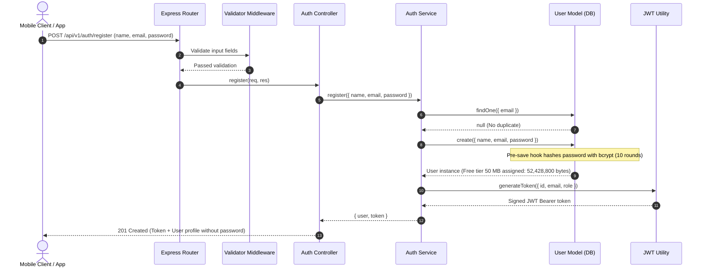
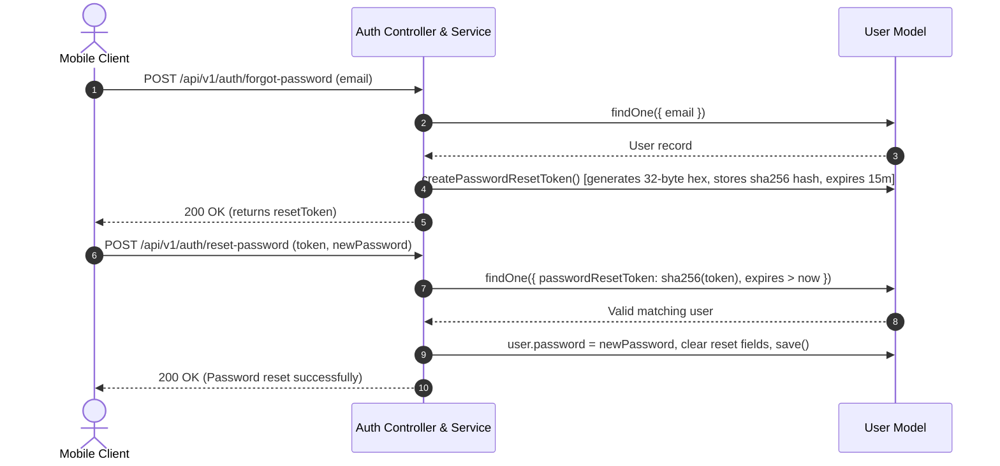
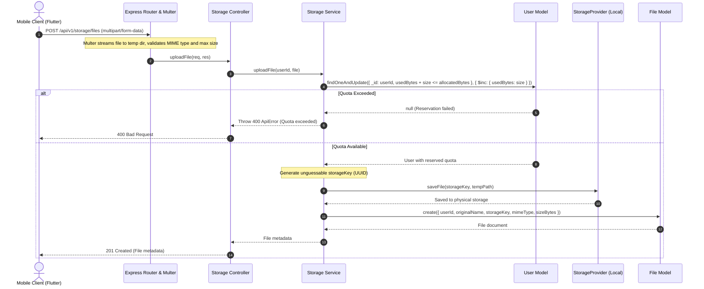
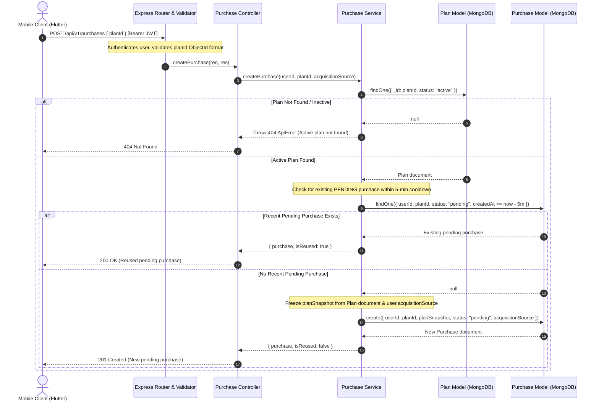
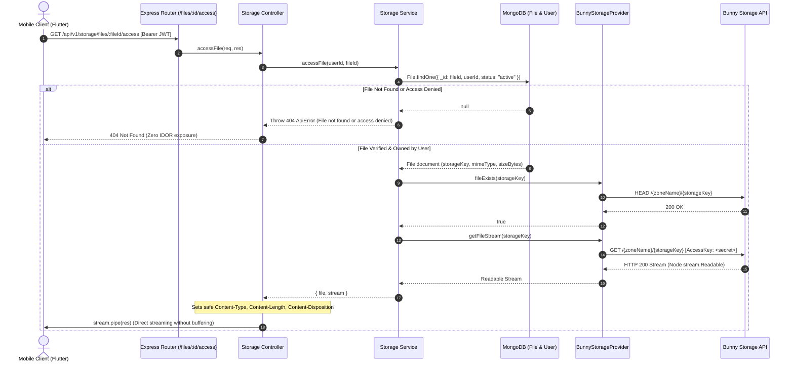

# Storify System Architecture & Roadmap Alignment

## Overview
Storify is a modular, production-ready cloud storage backend built with **Node.js, Express, MongoDB (Mongoose), and JWT**.

---

## Roadmap Alignment & Phase Breakdown

```
[Phase 1]
01. Foundation + Auth + User        <-- [COMPLETED]
02. Storage + Files                 <-- [COMPLETED]
03. Plans                           <-- [COMPLETED]
04. Purchase                        <-- [COMPLETED]
05. UPI Payment                     <-- Next
06. Automatic Access / Entitlement
07. Phase-1 Integration Testing
08. Play Store Testing
09. Production/Play Store Approval
        |
        +--> PHASE 1 COMPLETE

[Phase 2]
10. Admin Backend
11. Admin Frontend
12. Admin Configuration
13. Admin Approval
14. Premium Content
15. Advertisement-user business flow
16. Final Production Business Logic
```

---

## Component Architecture

```
d:\Storify\
|-- .env                     # Environment runtime variables
|-- .env.example             # Environment template
|-- package.json             # NPM dependencies & test scripts
|-- docs/
|   |-- API_DOCUMENTATION.md # REST API specs
|   |-- ARCHITECTURE.md      # Architecture & flow diagrams
|-- src/
|   |-- server.js            # Process bootstrapping, DB connection, graceful shutdown
|   |-- app.js               # Express application pipeline & security headers
|   |-- config/
|   |   |-- index.js         # Environment loader & validation (upload dir, max size)
|   |   |-- db.js            # Mongoose connection & lifecycle events
|   |-- constants/
|   |   |-- index.js         # Roles, Statuses, Plans, Purchase statuses, Acquisition sources
|   |-- storage/
|   |   |-- storage.provider.js       # Base storage abstraction contract
|   |   |-- local.storage.provider.js # Local disk implementation with traversal guards
|   |   |-- bunny.storage.provider.js # Bunny.net Storage HTTP API implementation
|   |   |-- index.js                  # Active storage provider factory & singleton
|   |-- middlewares/
|   |   |-- auth.middleware.js     # Bearer JWT extraction & verification
|   |   |-- role.middleware.js     # RBAC access control
|   |   |-- upload.middleware.js   # Multer disk-streaming & MIME filter
|   |   |-- validate.middleware.js # Express-validator runner
|   |   |-- error.middleware.js    # Central error & 404 response handler
|   |-- models/
|   |   |-- user.model.js        # User schema, password hashing (bcrypt), quota tracking, acquisitionSource
|   |   |-- file.model.js        # File metadata, storageKey, ownership indexes
|   |   |-- plan.model.js        # Plan schema, configurable values (300/500/900), sortOrder, status
|   |   |-- purchase.model.js    # Purchase schema, planSnapshot, acquisitionSource, paymentReference
|   |-- seeds/
|   |   |-- plan.seed.js     # Idempotent plan seeder (Free, Basic: 300, Premium: 500, Pro: 900)
|   |-- validators/
|   |   |-- auth.validator.js     # Request payload validation for auth
|   |   |-- user.validator.js     # Request payload validation for user updates
|   |   |-- storage.validator.js  # Request payload validation for file operations
|   |   |-- plan.validator.js     # Request parameter validation for plans
|   |   |-- purchase.validator.js # Request payload validation for purchases
|   |-- services/
|   |   |-- auth.service.js     # Registration, credential check, token generation
|   |   |-- user.service.js     # User profile management & storage computation
|   |   |-- storage.service.js  # File operations, atomic quota reservation, streaming
|   |   |-- plan.service.js     # Plan retrieval, active plan filtering, metadata exclusion
|   |   |-- purchase.service.js # Purchase creation, plan snapshotting, duplicate handling, retrieval
|   |-- controllers/
|   |   |-- auth.controller.js     # Auth endpoints controller
|   |   |-- user.controller.js     # User endpoints controller
|   |   |-- health.controller.js   # Healthcheck endpoint controller
|   |   |-- storage.controller.js  # Storage & file operations controller
|   |   |-- plan.controller.js     # Plan catalog endpoints controller
|   |   |-- purchase.controller.js # Purchase endpoints controller
|   |-- routes/
|   |   |-- index.js            # Master API v1 router
|   |   |-- auth.routes.js      # Auth routes
|   |   |-- user.routes.js      # User routes
|   |   |-- health.routes.js    # Health routes
|   |   |-- storage.routes.js   # Storage routes
|   |   |-- plan.routes.js      # Plan catalog routes
|   |   |-- purchase.routes.js  # Purchase routes
|   |-- utils/
|       |-- logger.js        # Winston logging system
|       |-- apiError.js      # Structured operational error class
|       |-- apiResponse.js   # Standardized JSON response envelope
|       |-- asyncHandler.js  # Async route exception wrapper
|       |-- token.util.js    # JWT sign & verify utilities
|-- tests/
    |-- unit/
    |   |-- apiError.test.js
    |   |-- token.util.test.js
    |   |-- user.model.test.js
    |   |-- file.model.test.js
    |   |-- storage.provider.test.js
    |   |-- storage.service.test.js
    |   |-- upload.middleware.test.js
    |   |-- plan.model.test.js
    |   |-- plan.service.test.js
    |   |-- plan.seed.test.js
    |   |-- purchase.model.test.js
    |   |-- purchase.service.test.js
    |   |-- bunny.storage.provider.test.js
    |   |-- storage.factory.test.js
    |-- integration/
        |-- health.test.js
        |-- auth.test.js
        |-- user.test.js
        |-- storage.test.js
        |-- plan.test.js
        |-- purchase.test.js
        |-- storage.bunny.test.js
```

---

## Authentication Flow


---

## Password Reset Flow


---

## File Upload & Quota Reservation Flow


---

## Security Practices
1. **Password Protection**: Passwords hashed with `bcryptjs` salt rounds (10), never stored or returned in plaintext (`select: false` on schema, deleted in `toJSON`).
2. **Token Security**: Tokens signed with secret (`APP_AUTH_S`) with configurable expiration (`APP_AUTH_E`).
3. **Password Reset Security**: Crypto-random 32-byte hex token hashed using SHA-256 before database persistence with a 15-minute strict time window.
4. **Storage Isolation & Zero Path Traversal**: Original filenames are never used for filesystem operations. Unique UUID keys are generated, sanitized with `path.basename()`, and checked to ensure resolution strictly within the upload root.
5. **Ownership Enforcement**: Every query requires matching `userId` and `_id`, strictly preventing cross-user file access, downloading, or deletion.
6. **Atomic Quota Accounting**: Concurrency is handled via atomic MongoDB reservations (`$expr: { $lte: [...] }`), with automatic compensation rollbacks if physical storage writes or DB inserts fail.
7. **Safe Streaming Access**: Files are streamed via Node streams (`pipe(res)`) without loading whole files into server RAM.
8. **MIME & Size Validation**: Centralized whitelist of allowed file types and single-file size constraints.
9. **Zero Third-Party/Social Dependencies**: Pure email & password authentication; no OTP or external social auth dependencies.
10. **Storage Isolation**: Free tier enforced at exactly 50 MB (52,428,800 bytes) default via `APP_VAL_1` configuration.
11. **HTTP Security Headers**: Enforced via `helmet`.
12. **CORS Control**: Configured via environment variable (`APP_SEC_O`).
13. **Operational Error Handling**: Central error handler masks stack traces in production and formats operational errors into clean JSON payloads.

---

## Plans Module Architecture (Phase 1 — Step 03)

### MongoDB Plan Documents as Runtime Single Source of Truth
MongoDB `Plan` documents are the **single source of truth** for runtime plan configuration.

```
Flutter Client
      ↓
GET /api/v1/plans
      ↓
Node.js Plan Service
      ↓
MongoDB Plans collection (Plan.find({ status: "active" }))
      ↓
Latest Plan values (storageBytes)
      ↓
Flutter Client
```

- **Runtime Invariant**: Plan values are **never** calculated from `.env` and **never** hardcoded in services/controllers.
- **Dynamic Updates**: If a plan's `storageBytes` is updated directly in MongoDB (e.g., `basic.storageBytes = 367001600` [350 MB]), the very next `GET /api/v1/plans` call immediately returns the updated value without code changes, `.env` modifications, or server restarts.
- **No Caching Layer in Phase 1**: Read operations query MongoDB directly to ensure zero cache-invalidation latency when plan documents are updated.

### Storage Allocation Values (Confirmed)
The numerical values represent storage allocation capacities:
- **Free**: 50 MB = `52,428,800` bytes
- **Basic**: 300 MB = `314,572,800` bytes
- **Premium**: 500 MB = `524,288,000` bytes
- **Pro**: 900 MB = `943,718,400` bytes

No commercial pricing, durations, or higher storage allocations (25GB/100GB/1TB) are assumed. Commercial fields (`price`, `currency`, `durationDays`) remain nullable (`null`).

```
+-----------------------------------------------------------------------+
| Phase 1: Step 03 (Plans Catalog)                                      |
|                                                                       |
| Client Request ---> GET /api/v1/plans ---> PlanService (DB Query)     |
|                              |                                        |
|                              v                                        |
|                     Return Active Plans                               |
|                     (Sorted by sortOrder)                             |
|                                                                       |
|  * NO purchase side effects                                           |
|  * NO payment or UPI interaction                                      |
|  * NO modification to user.storage.allocatedBytes                     |
+-----------------------------------------------------------------------+
                                   |
                                   v Future Transition
+-----------------------------------------------------------------------+
| Phase 1: Step 04 & 05 & 06 (Purchase, UPI, Entitlement)               |
|                                                                       |
| Order Creation ---> Payment Verification ---> Storage Entitlement     |
|                                               (allocatedBytes update) |
+-----------------------------------------------------------------------+
```

### Phase 1 vs Phase 2 Lifecycle
- **Phase 1**:
  - Plans are seeded initially via `npm run seed:plans`.
  - The seed script is idempotent and never overwrites existing/modified plans.
  - No Admin Plan APIs or Admin frontend exist in Phase 1.
  - The database can be directly updated for testing and configuration adjustments.
- **Phase 2**:
  - Admin Plan Management APIs (`POST`, `PUT`, `PATCH`, `DELETE`) will update these same MongoDB Plan documents.
  - Public Plan APIs will automatically return the latest active configuration without modifying database models or client contracts.

---

## Purchase Module Architecture (Phase 1 — Step 04)

### Purchase Creation & Snapshot Lifecycle


### Architectural Principles & Invariants

1. **Immutable Plan Snapshotting**:
   - `planSnapshot` locks in `{ planId, planCode, planName, storageBytes, price, currency, durationDays }` at purchase creation.
   - Future mutations to the live `Plan` document in MongoDB do not modify existing purchase records.

2. **Durable User Acquisition Source**:
   - The user's acquisition source (`ORGANIC` or `ADVERTISEMENT`) is durably persisted on the `User` document upon registration.
   - During purchase creation, this attribute is strictly inherited from `req.user.acquisitionSource`. Client requests cannot manipulate or override this source.

3. **Duplicate Purchase Protection (5-Minute Cooldown)**:
   - Prevents duplicate pending orders if users double-tap or re-enter the checkout flow.
   - If an identical user requests a purchase for the same plan within 5 minutes and the order is still `pending`, the existing purchase is returned idempotently.

4. **Zero Quota Modification Invariant**:
   - Neither `user.storage.allocatedBytes` nor `user.storage.usedBytes` is touched during Step 04.
   - Storage quotas remain strictly at 50 MB (Free tier) until Step 06 (Automatic Access / Entitlement) is reached.

5. **Forward Compatibility with Step 05 (UPI Payment)**:
   - The `Purchase` model provides a nullable `paymentReference` field reserved for UPI transaction IDs or gateway order references.

---

## Storage Provider Architecture (Bunny.net Storage Integration)

Storify provides a provider-agnostic storage abstraction layer allowing zero-downtime switching between local filesystem storage and Bunny.net Edge Storage.

### Provider Interface & Factory
```
                   +------------------------+
                   |  StorageProvider (Base)|
                   +------------------------+
                   | + saveFile()           |
                   | + getFileStream()      |
                   | + deleteFile()         |
                   | + fileExists()         |
                   | + getFileStats()       |
                   +-----------+------------+
                               |
             +-----------------+-----------------+
             |                                   |
+------------v-----------+          +------------v-----------+
|  LocalStorageProvider  |          |  BunnyStorageProvider  |
+------------------------+          +------------------------+
| Local disk persistence |          | Bunny HTTP REST API    |
| Upload directory       |          | Edge Storage Zone      |
| Zero network latency   |          | Regional API endpoints |
+------------------------+          +------------------------+
```

### Private Streaming Download Flow


### Quota Accounting & Failure Compensation
1. **Upload Pipeline**:
   - Quota reserved atomically (`User.findOneAndUpdate` with `$expr: { $lte: [...] }`).
   - Physical bytes streamed to Bunny Storage via HTTP PUT.
   - Metadata recorded in MongoDB `File` collection.
   - If Bunny PUT fails: quota reservation rolled back, temp disk file unlinked.
   - If MongoDB `File.create` fails: Bunny remote object deleted via `deleteFile`, quota rolled back, temp file unlinked.
2. **Delete Pipeline**:
   - Ownership verified via MongoDB query (`{ _id: fileId, userId }`).
   - Bunny object deleted via HTTP DELETE.
   - If remote object is already 404, handled safely as successful deletion.
   - If remote API fails (5xx/network): operation aborts; MongoDB record is preserved and quota is NOT decremented (zero inaccessible state).
   - MongoDB metadata removed and storage quota reclaimed exactly once.
3. **Fail-Safe Startup**:
   - If `APP_STG_DRIVER=bunny` is specified without valid credentials, the server fails safely with a descriptive error. Silent fallback to local storage is strictly disabled in production.


